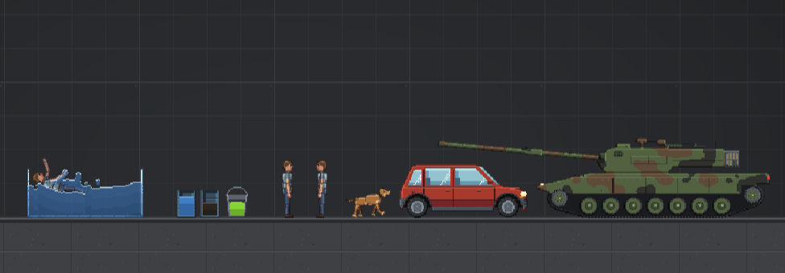

# Blueberry Playground

A 2D physics sandbox: spawn people, animals, weapons, vehicles and machines, and see what happens.
It runs in a browser, as a desktop app on Windows and Mac, and on phones and tablets.



## What's in it

- **People and animals** with ragdoll bodies: dogs, cats, cows, pigs, the Gorse, zombies and androids.
  Limbs bruise, bleed, break and tear off, heavy rounds take chunks out of them, and they can drown.
  A vitals panel and an x-ray show what's going on inside.
- **Fighting**: set two people on each other, or put people, animals and tanks on teams and watch
  the armies fight.
- **Weapons**: pistols to miniguns, swords and spears, a crossbow with six kinds of bolt, grenades,
  dynamite, C4, an RPG, Molotovs, a flamethrower and fireworks.
- **Vehicles**: cars, a truck and an SUV, plus four tanks (among them an M1 Abrams, a Leopard 2A7
  and a ZTZ-99A) you can drive and aim with the arrow keys.
- **Machines and electricity**: batteries, wires, switches, motors, pistons, thrusters, a jet
  engine, a tesla coil, turrets and detectors.
- **Building**: rope, fuse cord, welds, springs, pins and hinges, and wires. Draw your own shapes
  and save contraptions to reuse.
- **Water and liquids**: flowing water that fills tanks and finds its level, a sea to float or sink
  in, and electrified water. Pour water, oil and acid from flasks into buckets and barrels.
- **Fire and explosions**: things burn, oil catches, and blasts throw things about.
- **Maps** to pick from, an endless flat plate, and ground you draw yourself.
- **Multiplayer** over the internet (WebRTC, with a friends list), and tutorials that walk through it all.

## Playing

Download the latest version from **[Releases](https://github.com/VydeogamzDev/blueberry-playground/releases/latest)**:

- **Windows:** `Blueberry-Playground-<version>-windows.exe`, the desktop app in one file, with nothing to
  install. It's the smoothest way to play, because the physics runs on several cores at once. It isn't
  signed, so if SmartScreen stops it, click **More info**, then **Run anyway**.
- **Any computer:** `Blueberry-Playground-<version>.html`, the whole game in one page. Open it in a
  desktop browser (it's tested in Chrome).
- **Mac (Apple silicon):** `Blueberry-Playground-<version>-mac.tar.xz`. It needs two Terminal commands
  before it opens (see [below](#building-from-source), or the release notes).

- **iPhone, iPad and Android:** open **[blueberry-playground.vercel.app](https://blueberry-playground.vercel.app/)**
  in Safari (or Chrome), then **Share › Add to Home Screen**. It opens full screen like an app, and once
  it has loaded with a good signal it plays offline too (Settings › Saves and sync › Offline shows how
  much is saved). A page opened from a file can't run on an iPhone or iPad.

## Controls

These are the defaults, modelled on People Playground's. You can change any of them in the
Controls panel (F1).

| | |
|---|---|
| Left-drag | Move things (hold Shift to select several) |
| Right-click | The thing's menu: activate, heal, repair, freeze, team, settings… |
| Mouse wheel / middle-drag | Zoom / pan |
| F | Activate what's under the cursor or held (hold for automatic fire) |
| Space | Pause and resume |
| Q / E | Spawn facing left / right |
| A / D | Rotate |
| Z | Freeze / unfreeze |
| R | Flip |
| C / V | Copy / paste |
| Ctrl+Z | Undo |
| Delete | Delete |
| 1–8 | Tools: Drag, Rope (again: Fuse), Weld, Spring, Pin, Wire, Remove connections, Shape |
| Ctrl | Switch between tools and powers |
| G | Slow motion |
| S / X | Detail view / x-ray |
| J | Jump (people and animals) |
| Arrows | Move the camera, or drive the selected vehicle (↑ ↓ aim a tank) |
| Tab | Show or hide the toybox |
| Esc | Pause menu |
| F1 or H | Every control |

## Building from source

You need [Node.js](https://nodejs.org) 20.19 or newer, and Chrome for the tests.

```bash
npm install
npm run dev               # the game at http://localhost:5173, reloading as you edit
npm run standalone        # dist-standalone/Blueberry Playground.html: the whole game in one file
npm run desktop           # the desktop app (Electron), on this computer
npm run desktop:build     # Windows: a portable .exe and an installer, in dist-desktop/out
npm run desktop:mac       # Mac (Apple silicon), made on Windows: a .tar.xz in dist-desktop/out
npm test                  # the self-tests, in headless Chrome
```

Add `-- --downloads` to `standalone`, `desktop:build` or `desktop:mac` to copy the result into your
Downloads folder, named with the version.

The Mac app isn't signed, so macOS calls it damaged until it's signed on the Mac it runs on.
Unpack it, then in Terminal:

```
xattr -cr "Blueberry Playground.app"
codesign --force --deep --sign - "Blueberry Playground.app"
```

### Layout

| | |
|---|---|
| `src/world` | The game: entities, parts, saving and loading, maps |
| `src/entities` | Everything you can spawn: people, animals, weapons, vehicles, machines |
| `src/systems` | Fire, liquids and water, breath, electricity, fighting and teams, particles |
| `src/catalog` | The toybox: each item's art, stats and description |
| `src/art` | Pixel art, drawn in code |
| `src/engine` | Physics, rendering, sound, music, storage |
| `src/tools`, `src/ui` | Controls, building tools and the interface |
| `src/net` | Multiplayer |
| `src/debug/tests` | The self-tests (`npm test`) |
| `desktop`, `tools` | The Electron app, build scripts, and the physics engine's build (`tools/rapier`) |

The physics engine is [Rapier](https://rapier.rs) with our own patch, built into `vendor/rapier`.
See [tools/rapier/README.md](tools/rapier/README.md) to change it (that needs Rust).

## Changes

See [CHANGELOG.md](CHANGELOG.md).

## License

Blueberry Playground's own code and art are licensed under the
[PolyForm Noncommercial License 1.0.0](LICENSE.md). Roughly, you may play it, study it, change it
and share it, but not for commercial purposes. Selling it, or using it in anything commercial, needs
permission from VydeogamzDev. The license text is what counts.

Some parts keep their own licenses:

- **Sounds and music** (`public/sfx`, `public/music`): CC0 1.0 (public domain), from Kenney,
  OpenGameArt and Freesound. Each source is credited in
  [public/sfx/CREDITS.md](public/sfx/CREDITS.md).
- **Rapier** (`vendor/rapier`, `tools/rapier`): Apache License 2.0, by Dimforge, with our changes
  described in `tools/rapier`.
- **Libraries** used in the builds: [three.js](https://threejs.org) (MIT),
  [PeerJS](https://peerjs.com) (MIT), [Electron](https://www.electronjs.org) (MIT), and the
  DotGothic16 and Tiny5 fonts (SIL Open Font License 1.1, via Fontsource).
